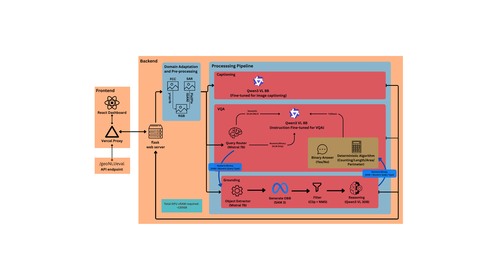

# GeoNLI — Geospatial Natural Language Interface

**ISRO Inter-IIT Tech Meet 14.0**

GeoNLI is a geospatial image understanding system that lets users interact with
Earth Observation (EO) imagery using natural language. It combines a React web
interface with a Flask inference backend to deliver three core capabilities:

- **Image captioning** — one-sentence scene descriptions of satellite imagery
- **Visual question answering (VQA)** — binary (yes/no), numeric (counts, areas,
  perimeters, lengths), and semantic questions about image content
- **Text-guided visual grounding** — locating described objects with oriented
  bounding boxes (8-point corner format) via SAM3



---

## Problem Statement

Analyzing satellite imagery traditionally requires specialized GIS tools and
manual inspection. GeoNLI lowers that barrier: a user uploads an image (RGB,
false-color composite, or SAR) and asks questions in plain English. The system
handles image conversion, routes the request to the right model, and returns
answers plus grounded object locations.

## Key Features

| Capability | Status | Notes |
|---|---|---|
| RGB image captioning | Verified (code path) | Shared Qwen3-VL VLM, concise-sentence prompt |
| FCC (false-color composite) → RGB conversion | Verified (code path) | Band-remap conversion in `backend/utils/image_ops.py` |
| SAR → optical RGB conversion | Optional | Requires Pix2Pix checkpoint; endpoint returns 503 if weights are missing |
| Binary VQA (yes/no) | Verified (code path) | Answer canonicalized to `Yes`/`No` |
| Numeric VQA (count/area/perimeter/length) | Optional path | Uses SAM3 detections + spatial resolution; VLM-only fallback |
| Semantic VQA | Verified (code path) | Short answer via shared VLM |
| Text-guided grounding (SAM3) | Verified (code path) | Persistent SAM3 service; returns normalized 8-coordinate boxes |
| GPU memory scheduler | Verified (code path) | Exclusive VLM/SAM3 placement with fair FIFO locking |
| Request timeouts & inference error handling | Verified (code path) | Friendly client-facing messages; server logs retain details |

> "Verified (code path)" means the behavior is implemented in the source and
> covered by lightweight contract tests where noted. Heavy model inference was
> **not** executed during repository publication; see *Testing* below.

## System Architecture

```
┌────────────────────┐      HTTP / JSON or multipart      ┌─────────────────────────┐
│  React + Vite UI   │ ───────────────────────────────────▶ │  Flask backend          │
│  (ui/frontend)     │ ◀─────────────────────────────────── │  (backend/, port 8000)  │
└────────────────────┘      JSON { success, answer, ... }  └───────────┬─────────────┘
                                                                      │
                         ┌────────────────────────────────────────────┼──────────────┐
                         │                                            ▼              │
                         │  ┌───────────────────────┐   ┌───────────────────────────┐ │
                         │  │ Model manager         │   │ GPU inference lock +       │ │
                         │  │ (backend/core/model)  │   │ placement scheduler       │ │
                         │  └───────┬───────────────┘   └───────────────────────────┘ │
                         │          │                                                    │
                         │  ┌───────▼───────────────────────────────────────────────┐   │
                         │  │ Shared VLM: Qwen/Qwen3-VL-2B-Instruct (+ optional     │   │
                         │  │ PEFT caption adapter from CAPTIONING_MODEL_DIR)      │   │
                         │  │ Optional dedicated VQA checkpoint from VQA_MODEL_DIR   │   │
                         │  └───────┬───────────────────────────────────────────────┘   │
                         │          │                                                    │
                         │  ┌───────▼───────────────────────────────────────────────┐   │
                         │  │ SAM3 grounding service (models/sam3)                  │   │
                         │  │ Persistent process; 8-point oriented boxes            │   │
                         │  └───────────────────────────────────────────────────────┘   │
                         └────────────────────────────────────────────────────────────────┘
```

### Inference pipeline

1. **Request intake** — `POST /geoNLI/eval` accepts either a JSON evaluation
   payload (image URL + query bundle) or a multipart frontend upload (image
   file + `task_type`, `query`, `image_type`, `spatial_resolution_m`).
2. **Image conversion** — FCC imagery is remapped to RGB bands; SAR imagery is
   converted by a lazy-loaded Pix2Pix generator (fails gracefully with HTTP
   503 when no checkpoint is configured).
3. **Query dispatch** — grounding queries go to the persistent SAM3 service;
   caption/VQA queries go through the model manager. A fair, reentrant GPU
   lock plus a placement scheduler ensures the VLM and SAM3 never hold full
   weights on the GPU simultaneously (they are swapped CPU↔GPU per task).
4. **Answer post-processing** — binary answers are canonicalized to `Yes`/`No`;
   numeric answers are extracted and, on the routed path, computed
   deterministically from SAM3 detections using `spatial_resolution_m`
   (meters/pixel) for area (m²), perimeter (m), and length (m), and instance
   counts. Detector failures fall back to VLM-only answers with a
   `fallback_reason`.
5. **Response** — JSON with `success`, `answer`/`response`, `bboxes`,
   `request_id`, and `timestamp`; the JSON evaluation mode echoes the input
   schema with per-query `response` fields populated.

## Repository Structure

```
GeoNLI/
├── README.md                  # This file
├── requirements.txt           # Pinned Python dependencies (backend + models)
├── setup_gpu.sh               # One-shot environment/setup helper (optional)
│
├── backend/                   # Flask inference server
│   ├── app.py                 # Application factory, request logging, CORS
│   ├── config.py              # Env-driven configuration
│   ├── requirements.txt       # Same pinned dependency set as root
│   ├── api/routes.py          # /geoNLI/eval and /geoNLI/health
│   ├── core/model.py          # Model manager, VLM/VQA wrappers, routing
│   ├── services/
│   │   ├── sam3_runner.py     # Persistent SAM3 grounding client
│   │   ├── sar_converter.py   # Lazy Pix2Pix SAR→RGB converter
│   │   ├── inference_lock.py  # Fair GPU lock + placement scheduler
│   │   ├── request_context.py # Per-request ID propagation (contextvars)
│   │   └── query_router.py    # Routing helpers (optional SAM+VLM path)
│   ├── utils/image_ops.py     # URL/file loading, FCC conversion, uploads
│   └── tests/                 # Lightweight contract tests (mocked models)
│
├── models/                    # Model implementations
│   ├── captioning.py          # Qwen3-VL captioning/VLM backend (+ PEFT adapter)
│   ├── vqa.py                 # Fine-tuned Qwen3-VL VQA backend (optional)
│   ├── device.py              # CUDA/MPS/CPU selection
│   ├── sam3/                  # SAM3 grounding pipeline (vendored, SAM License)
│   └── SAR2Optical/           # Pix2Pix SAR→optical training/inference code
│
├── ui/frontend/               # React 19 + Vite 7 + Tailwind 4 web interface
│   ├── src/components/        # Dashboard, stage, command bar, cards, ...
│   ├── src/services/api.js    # Backend client (90 s timeout, simulation mode)
│   └── api/geoNLI/eval.js     # Optional Vercel serverless proxy
│
├── VQA-fine-tuning/           # Training code for the dedicated VQA checkpoint
├── Images/                    # Documentation figures
└── *.pdf                      # User guide and team reports
```

## Technology Stack

**Backend:** Python 3.10, Flask 3, Flask-CORS, PyTorch 2.9 (CUDA 12.x),
Transformers 4.57, PEFT, Accelerate, SAM3 (vendored)

**Frontend:** React 19, Vite 7, Tailwind CSS 4, Lucide icons, Vercel (optional)

**Models:** Qwen/Qwen3-VL-2B-Instruct (shared VLM backbone), optional PEFT
caption adapter, optional fine-tuned Qwen3-VL VQA checkpoint, SAM3 (Segment
Anything Model 3) for grounding

## Hardware Requirements

- **GPU:** NVIDIA GPU with ≥6 GiB VRAM recommended. The default Qwen3-VL-2B
  backbone with bf16 plus SAM3 is designed to fit and swap on a 6 GiB card.
  CPU-only execution is supported but impractically slow for repeated use.
- **RAM:** ≥16 GiB system RAM (models are swapped between CPU and GPU).
- **Disk:** ~10 GiB free (models, SAM3, caches, converted images).

## Software Prerequisites

- NVIDIA driver supporting CUDA 12.x and `nvidia-smi` working
- Python 3.10 (a conda env named `py310` is used in development, but any
  3.10 environment works)
- Node.js 20+ and npm 10+ (frontend only)
- Git

## Installation

```bash
git clone https://github.com/raxgvv/GeoNLI.git
cd GeoNLI
```

### Conda environment (recommended)

```bash
conda create -n py310 python=3.10 -y
conda activate py310
```

### Python dependencies

`requirements.txt` pins the versions the code was developed and tested against
(Python 3.10). If you need CUDA-enabled PyTorch and it is not already
installed, install the matching PyTorch wheels first:

```bash
# Example for CUDA 12.8 — choose the index matching your driver
pip install torch==2.9.1 torchvision==0.24.1 --index-url https://download.pytorch.org/whl/cu128
```

Then install the project dependencies:

```bash
pip install -r requirements.txt
```

### Hugging Face access

The VLM backbone, processors, and (optionally) adapters are downloaded from
the Hugging Face Hub on first use. For gated or private models, authenticate:

```bash
pip install huggingface-hub
huggingface-cli login        # or: export HF_TOKEN=...
```

Qwen3-VL-2B-Instruct is publicly reachable; authentication is only required
if you configure a gated model via `ADV_VLM_MODEL_ID`.

## Model Setup

Model weights are **not** bundled in the repository (`.gitignore` excludes
checkpoints). The system degrades gracefully when optional models are absent.

| Model | Env var | Default location | Required? |
|---|---|---|---|
| Qwen3-VL-2B VLM backbone | `ADV_VLM_MODEL_ID` | Downloaded from HF Hub | Yes (auto-downloaded) |
| Caption PEFT adapter | `CAPTIONING_MODEL_DIR` | `models/captioning-model` | No — warns and uses the base model without fine-tuning |
| VQA checkpoint | `VQA_MODEL_DIR` | `models/vqa-model` | No — falls back to the shared VLM if incomplete |
| SAM3 pipeline | `SAM3_ROOT` | `models/sam3` (vendored) | Yes for grounding |
| SAR Pix2Pix checkpoint | `SAR2OPTICAL_CHECKPOINT` | `models/SAR2Optical/pix2pix_gen_180.pth` | Only for SAR inputs |

The fine-tuned VQA checkpoint and training data references are described under
`VQA-fine-tuning/`. Shared fine-tuned weights are also linked from the original
submission (Google Drive) for reproducibility.

## Environment Variables

All variables are optional; defaults match a stock checkout.

| Variable | Default | Purpose |
|---|---|---|
| `BACKEND_PORT` | `8000` | Flask listen port |
| `BACKEND_DEBUG` | `0` | Set `1` for Flask debug mode |
| `ADV_VLM_MODEL_ID` | `Qwen/Qwen3-VL-2B-Instruct` | Shared vision-language backbone |
| `ADV_VLM_TEMPERATURE` | `0.2` | Sampling temperature (0 = greedy) |
| `ADV_VLM_MAX_NEW_TOKENS` | `64` | Generation cap for captioning |
| `CAPTION_GENERATION_TIMEOUT_S` | `50` | Per-caption wall-clock timeout |
| `VQA_MAX_NEW_TOKENS` | `128` | Generation cap for the dedicated VQA checkpoint |
| `CAPTIONING_MODEL_DIR` | `models/captioning-model` | Local adapter/processor directory |
| `VQA_MODEL_DIR` | `models/vqa-model` | Dedicated VQA checkpoint directory |
| `SAM3_ROOT` | `models/sam3` | Vendored SAM3 pipeline location |
| `SAR2OPTICAL_CHECKPOINT` | `models/SAR2Optical/pix2pix_gen_180.pth` | SAR→RGB Pix2Pix weights |
| `GEONLI_LOG` | `geonli.log` (repo root) | Backend log file path |
| `HF_TOKEN` / `HUGGING_FACE_HUB_TOKEN` | — | Hugging Face authentication |

## Backend Startup

```bash
# from the repository root
python -m backend.app
# → http://0.0.0.0:8000  (health check: GET /geoNLI/health)
```

## Start and Stop Both Services

From the project root, start the backend with the `py310` Conda environment and
the Vite development frontend together:

```bash
cd ~/Inter-IIT
python start_geonli.py
```

The launcher prints the frontend URL and backend health URL when each is ready.
Use that frontend URL in your browser. To open it once automatically, run
`python start_geonli.py --open`. Check launcher-managed processes with
`python start_geonli.py --status`.

Stop both launcher-managed services with:

```bash
cd ~/Inter-IIT
python stop_geonli.py
```

Prefixed service output is shown in the terminal and saved to `logs/backend.log`
and `logs/frontend.log`; backend application logs are also written to
`logs/backend-app.log`. `logs/` is ignored by Git. If startup fails, review
those logs and the launcher's reported missing dependency or occupied port.
The launcher does not terminate processes it did not start. Check GPU use with
`nvidia-smi`; stopping GeoNLI releases memory when its backend exits, while
other applications may continue to use GPU memory.

## Frontend Startup

```bash
cd ui/frontend
cp .env.example .env          # then edit VITE_BACKEND_BASE_URL
npm install
npm run dev                   # → http://localhost:5173
```

Production build: `npm run build` (output in `ui/frontend/dist`). The optional
Vercel proxy under `ui/frontend/api/` forwards evaluation requests to the
backend over HTTPS.

## API Documentation

Base URL: `http://<backend-host>:8000`

### `GET /geoNLI/health`

Liveness probe. Response `200`:

```json
{"status": "active", "success": true, "timestamp": "2026-10-10T12:00:00+00:00"}
```

### `POST /geoNLI/eval`

Two content types are accepted.

#### a) Multipart (frontend uploads)

| Field | Type | Required | Values |
|---|---|---|---|
| `image` | file | Yes | PNG/JPEG upload (≤16 MB) |
| `task_type` | string | Yes | `captioning`, `vqa`, `grounding` |
| `vqa_type` | string | For `vqa` | `semantic`, `binary`, `numeric` |
| `image_type` | string | Yes | `RGB`, `FCC`, `SAR` |
| `query` | string | For `vqa`/`grounding` | Natural-language instruction |
| `spatial_resolution_m` | float | Yes | Meters per pixel, > 0 |

Success response `200`:

```json
{
  "success": true,
  "task": "vqa",
  "answer": "Yes",
  "response": "Yes",
  "bboxes": [],
  "request_id": "a1b2c3d4e5f6",
  "timestamp": "2026-10-10T12:00:05+00:00"
}
```

Error response (e.g. `400`/`415`/`503`/`504`):

```json
{"success": false, "error": "task_type must be captioning, vqa, or grounding", "request_id": "...", "timestamp": "..."}
```

#### b) JSON (evaluation harness)

```json
{
  "input_image": {
    "image_url": "https://example.com/scene.jpg",
    "mode": "RGB",
    "metadata": {"spatial_resolution_m": 1.57}
  },
  "queries": {
    "caption_query": {"instruction": "Describe"},
    "grounding_query": {"instruction": "Locate aircraft"},
    "attribute_query": {
      "binary": {"instruction": "Is there water visible?"},
      "numeric": {"instruction": "How many vehicles are there?"},
      "semantic": {"instruction": "What terrain is shown?"}
    }
  }
}
```

The endpoint echoes the input payload with each query's `response` populated:
`caption_query.response` is the caption string; `grounding_query.response` is a
list of `{"object-id": "1", "obbox": [x1,y1,...x4,y4]}` entries (normalized
8-point corners); `attribute_query.{binary,numeric,semantic}` gain `response`,
and binary/numeric additionally gain `route` (`VLM_ONLY` by default),
`numeric_type`, `numeric_value`, `bboxes`, and `filtered_instances`.
`converted_rgb_path` is added to `input_image` when FCC/SAR conversion ran.

## Supported VQA Modes

| Mode | Behavior |
|---|---|
| `binary` | Answer canonicalized to `Yes`/`No`; invalid VLM output raises an error surfaced to the client |
| `numeric` | First numeric token extracted; routed path computes count/area/perimeter/length from SAM3 detections using `spatial_resolution_m` |
| `semantic` | Free-form short answer (max 64 tokens) |

## Grounding Usage

Grounding runs the vendored SAM3 pipeline (`models/sam3/unified_inference.py`)
through a persistent service. Detections are returned as normalized 8-coordinate
corner lists (`[x1, y1, ..., x4, y4]`, values in 0–1 relative to image
dimensions), plus a base64 JPEG visualization (`grounded_image`) internally.
SAM3 requires a SAM3 checkpoint on disk; see `models/sam3/README.md` for its
setup and the SAM License that applies to that vendored code.

## Testing and Troubleshooting

Lightweight contract tests (mocked models, no GPU required):

```bash
python -m pytest backend/tests/test_eval_api.py -q
python -m pytest backend/tests/test_sam3_postprocessing.py -q
```

Frontend checks:

```bash
cd ui/frontend && npm run lint && npm run build
```

Common issues:

- **GPU out of memory** — the scheduler swaps models CPU↔GPU exclusively; keep
  other GPU applications closed and use images ≤16 MB.
- **SAR conversion fails (503)** — set `SAR2OPTICAL_CHECKPOINT` to a valid
  Pix2Pix generator, or upload pre-converted RGB/FCC imagery.
- **Caption times out (504)** — lower `ADV_VLM_MAX_NEW_TOKENS` or raise
  `CAPTION_GENERATION_TIMEOUT_S`; the default is 50 s.
- **VLM did not return a valid yes/no answer** — retry, or rephrase the
  question; the canonicalizer requires an unambiguous yes/no token.
- **Adapter warning at startup** — informational only; captioning continues
  with the base Qwen3-VL model.
- **Frontend cannot reach the backend** — set `VITE_BACKEND_BASE_URL` in
  `ui/frontend/.env`; the client aborts after 90 s.

## Known Limitations

- The dedicated VQA checkpoint and the PEFT caption adapter are optional and
  not bundled; without them, all tasks run on the shared Qwen3-VL-2B backbone.
- SAM3 grounding requires a local SAM3 checkpoint; downloads are not scripted.
- Numeric VQA depends on SAM3 detection quality; unrouted numeric answers are
  VLM-extracted and may be imprecise.
- The query router (`SAM_PLUS_VLM` routed numeric path) is implemented but
  disabled by default (`router = None`) to avoid loading a second large model.
- CPU-only execution is supported but slow.
- No real-model inference was run during publication of this repository;
  claims above reflect code paths and mocked contract tests only.

## Future Improvements

- Bundle or auto-fetch the fine-tuned caption adapter and VQA checkpoint
- Enable the SAM+VLM routed numeric path when GPU headroom allows
- Streaming token output for long captions
- Batch evaluation endpoint for judge harnesses
- Persistent disk cache for repeated grounding queries

## License

This repository does not carry a project-wide license: no original code here is
licensed for redistribution, and no ownership is claimed over third-party
weights. Vendored third-party components retain their own licenses — notably
`models/sam3` is distributed under the **SAM License** (see
`models/sam3/LICENSE`), and pretrained models (Qwen3-VL, SAM3) remain subject
to their respective upstream licenses.

---

*Developed for ISRO Inter-IIT Tech Meet 14.0.*
