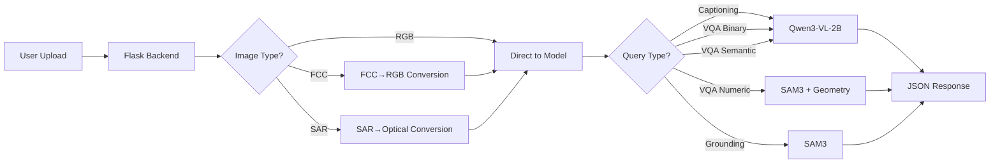

# 01 — Project Overview and Executive Summary

## What is GeoNLI?

**GeoNLI** stands for **Geospatial Natural Language Interface** [Code: README.md:1].

It is a geospatial image understanding system that lets users interact with Earth Observation (EO) imagery using natural language. A user uploads a satellite image (RGB, false-color composite, or SAR) and asks questions in plain English. The system handles image conversion, routes the request to the right model, and returns answers plus grounded object locations [Code: README.md:5-13].

**Built for ISRO Inter-IIT Tech Meet 14.0**.

---

## The Problem It Addresses

Analyzing satellite imagery traditionally requires specialized GIS tools and manual inspection. GeoNLI lowers that barrier by providing [Code: README.md:25-29]:

1. **Natural language interaction** — no specialized software knowledge needed
2. **Multi-modal image support** — RGB, false-color composite, and SAR imagery
3. **Multiple question types** — captions, yes/no questions, numeric measurements, semantic queries, and object localization

---

## Intended Users

- Remote sensing analysts who need quick scene descriptions
- Researchers who need to query large image collections
- Judges/evaluators who use the JSON API for benchmarking
- Anyone who needs to interact with satellite imagery without GIS expertise

---

## Expected Inputs

| Input Type | Format | Source |
|---|---|---|
| RGB image | PNG/JPEG upload or URL | Frontend file upload or JSON API |
| FCC image | PNG/JPEG (NIR,R,G bands) | Frontend or JSON API |
| SAR image | PNG/JPEG | Frontend or JSON API |
| Query | Natural language text | Frontend command bar or JSON API |
| Spatial resolution | Float (meters/pixel) | Frontend form or JSON metadata |

---

## Expected Outputs

| Output | Description |
|---|---|
| Caption | One-sentence scene description |
| Binary answer | "Yes" or "No" (canonicalized) |
| Numeric answer | Count, area (m²), perimeter (m), or length (m) |
| Semantic answer | Free-form short text answer |
| Bounding boxes | Normalized 8-coordinate corner lists `[x1,y1,...,x4,y4]` |
| Grounded image | Base64 JPEG visualization with overlaid boxes |

---

## Major Capabilities (Verified from Code)

### 1. Image Captioning [Code]
- **File:** `models/captioning.py` — `CaptioningBackend`
- **Model:** Qwen/Qwen3-VL-2B-Instruct (shared backbone)
- **Optional enhancement:** LoRA adapter on Qwen3-VL-8B-Instruct (`models/captioning-model/model/adapter_config.json`)
- **Prompt:** "Describe the main visible content in this image in one concise sentence." [Code: models/captioning.py:121]
- **Generation:** max_new_tokens=64, temperature=0.2, max_pixels=384×384 [Code: backend/config.py:35]

### 2. Visual Question Answering (VQA) [Code]
- **Binary questions:** Answer canonicalized to "Yes"/"No" [Code: backend/core/model.py:276-286]
- **Numeric questions:** Count, area, perimeter, length computed from SAM3 detections [Code: backend/core/model.py:307-344]
- **Semantic questions:** Free-form short answer [Code: backend/core/model.py:170-178]
- **Optional dedicated model:** Fine-tuned Qwen3-VL-8B checkpoint at `models/vqa-model/` [Code: models/vqa.py]

### 3. Text-Guided Visual Grounding [Code]
- **File:** `models/sam3/runtime_service.py` — `Sam3GroundingService`
- **Model:** SAM3 (Segment Anything Model 3)
- **Output:** 8-coordinate oriented bounding boxes (normalized 0-1) [Code: backend/services/sam3_runner.py:64-77]
- **Pipeline:** Text prompt → SAM3 mask generation → OBB extraction → NMS → visualization

### 4. Image Type Conversion [Code]
- **FCC → RGB:** Band-remap conversion using linear combination [Code: backend/utils/image_ops.py:34-55]
  - Synthetic blue = 13.9053 + 0.873393×green + (−0.138254)×red + (−0.100616)×NIR
- **SAR → Optical:** Pix2Pix UNet generator [Code: backend/services/sar_converter.py]
  - Lazy-loaded, requires checkpoint at `models/SAR2Optical/pix2pix_gen_180.pth`

### 5. GPU Memory Scheduler [Code]
- **File:** `backend/services/inference_lock.py`
- **Mechanism:** Fair FIFO reentrant lock + exclusive placement scheduler
- **Behavior:** VLM and SAM3 never hold full GPU weights simultaneously; models swap CPU↔GPU per task [Code: backend/services/inference_lock.py:58-112]

---

## Principal Technical Challenges

1. **GPU memory constraint:** Multiple large models (VLM 2B, SAM3, optional 8B VQA) must share a single GPU (target: 6 GiB)
2. **Heterogeneous image inputs:** RGB, FCC, and SAR imagery require different preprocessing
3. **Diverse query types:** Different question types need different model pipelines
4. **Geospatial measurement:** Numeric answers require converting pixel measurements to real-world units using spatial resolution
5. **Grounding accuracy:** SAM3 produces masks, but the system needs oriented bounding boxes

---

## Overall Solution

---

## Main System Components

| Component | Technology | Location |
|---|---|---|
| Frontend | React 19, Vite 7, Tailwind 4 | `ui/frontend/` |
| Backend | Flask 3, Flask-CORS | `backend/` |
| VLM Backbone | Qwen3-VL-2B-Instruct (Transformers) | `models/captioning.py` |
| VQA Model | Qwen3-VL-8B (fine-tuned, optional) | `models/vqa.py` |
| Grounding | SAM3 (vendored) | `models/sam3/` |
| SAR Conversion | Pix2Pix UNet | `models/SAR2Optical/` |
| GPU Scheduler | Custom fair lock + placement | `backend/services/inference_lock.py` |
| Query Router | Mistral-7B (disabled) | `backend/services/query_router.py` |

---

## Project Workflow

1. **User uploads image** via frontend (drag-and-drop or file picker)
2. **User selects task type** (grounding, VQA with subtype, or captioning)
3. **Frontend sends multipart request** to `POST /geoNLI/eval`
4. **Backend validates** task type, image type, and query
5. **Image conversion** if FCC or SAR
6. **Query dispatch:**
   - Grounding → SAM3 service
   - Captioning/VQA → ModelManager → VLM or VQA backend
7. **Post-processing:** canonicalize answers, compute numeric values from geometry
8. **JSON response** returned to frontend
9. **Frontend renders** results (bounding boxes on image, answer in log sheet)

---

## Current Limitations

| Limitation | Evidence |
|---|---|
| SAM3 checkpoint not bundled | `.gitignore` excludes `*.pt` files; needs manual download |
| Pix2Pix checkpoint not bundled | `.gitignore` excludes `*.pth` files; SAR conversion returns 503 without it |
| Query router disabled | `self.router = None` in ModelManager [Code: backend/core/model.py:225] |
| CPU-only is impractically slow | README states this explicitly [Doc: README.md:154] |
| No real-model inference during publication | README states this [Doc: README.md:47] |
| VQA model loads on GPU only | `VQABackend` uses `torch.bfloat16` on CUDA [Code: models/vqa.py:83] |
| Numeric VQA depends on SAM3 quality | Fallback to VLM-only when SAM3 fails [Code: backend/core/model.py:364-382] |

---

## One-Minute Explanation

> "GeoNLI is a geospatial image understanding system I built for ISRO's Inter-IIT Tech Meet. It lets users upload satellite imagery and interact with it using natural language — asking for captions, yes/no questions, numeric measurements like area and perimeter, and locating objects with bounding boxes. The system combines a React frontend with a Flask backend that orchestrates multiple AI models: a Qwen3-VL vision-language model for captioning and VQA, SAM3 for text-guided segmentation and grounding, and a Pix2Pix network for SAR-to-optical conversion. A custom GPU scheduler ensures all models fit on a single 6-gigabyte card by swapping them between CPU and GPU exclusively. The project includes fine-tuned checkpoints for both captioning (LoRA adapter) and VQA (full fine-tune of Qwen3-VL-8B on a remote sensing dataset), though these are optional and the system degrades gracefully when they're absent."

---

## Beginner-Friendly Explanation

Imagine you have a satellite image and want to know what's in it. Instead of using complex GIS software, you can:
1. Upload the image to a web page
2. Type a question like "How many buildings are there?" or "Find the airplanes"
3. The AI system analyzes the image and tells you the answer, showing you exactly where things are on the image

GeoNLI does exactly this — it's like a smart assistant for satellite images that can describe scenes, answer questions, and point to specific locations in the image.

---

*Next: [System Architecture](02_system_architecture.md)*
