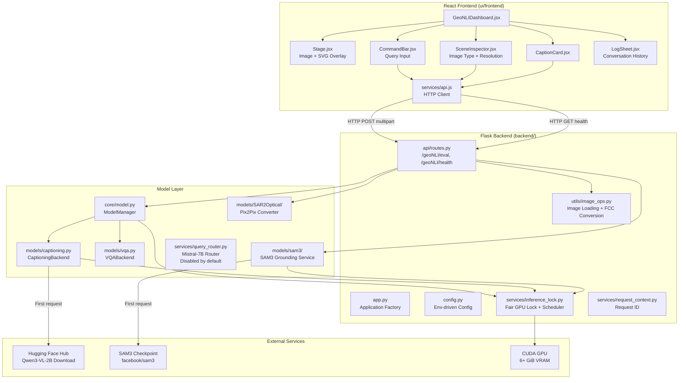
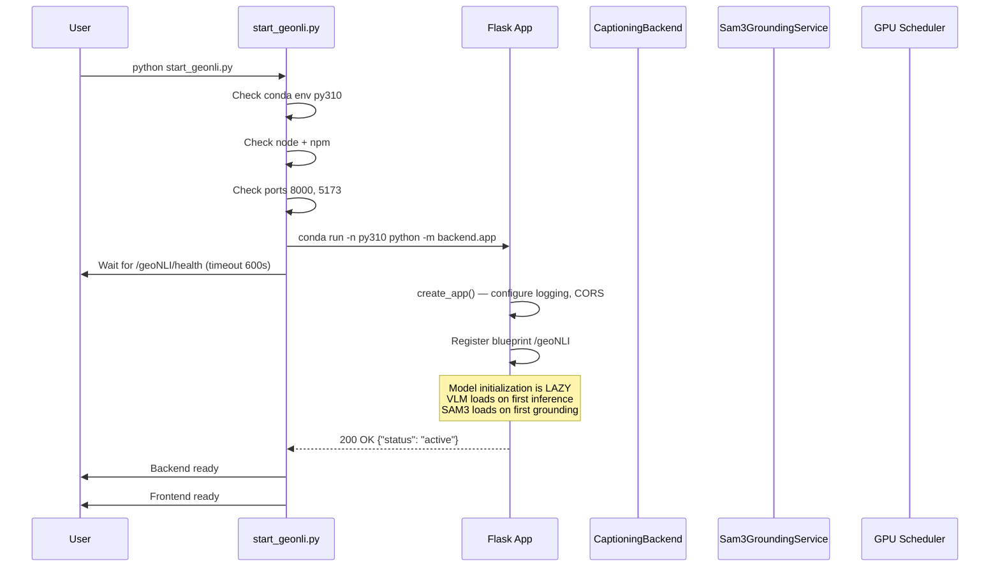
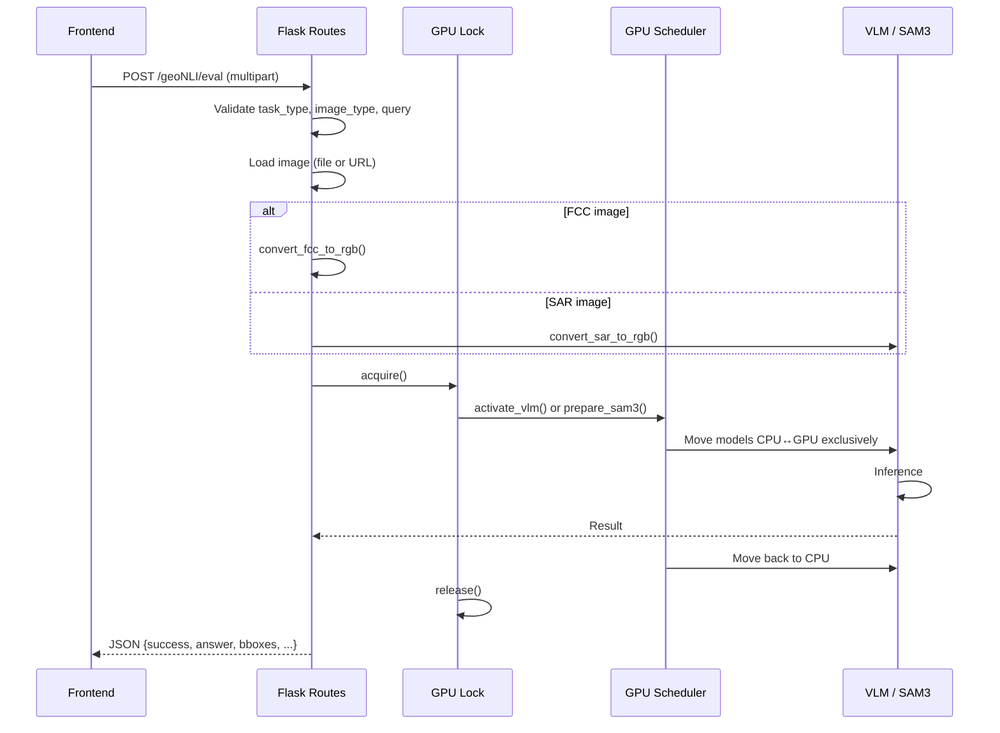
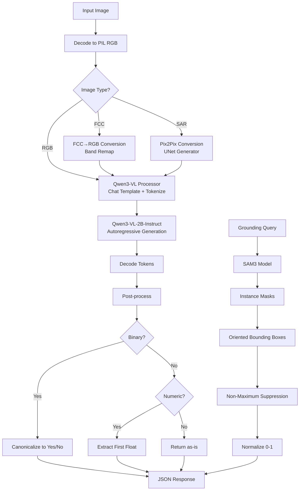
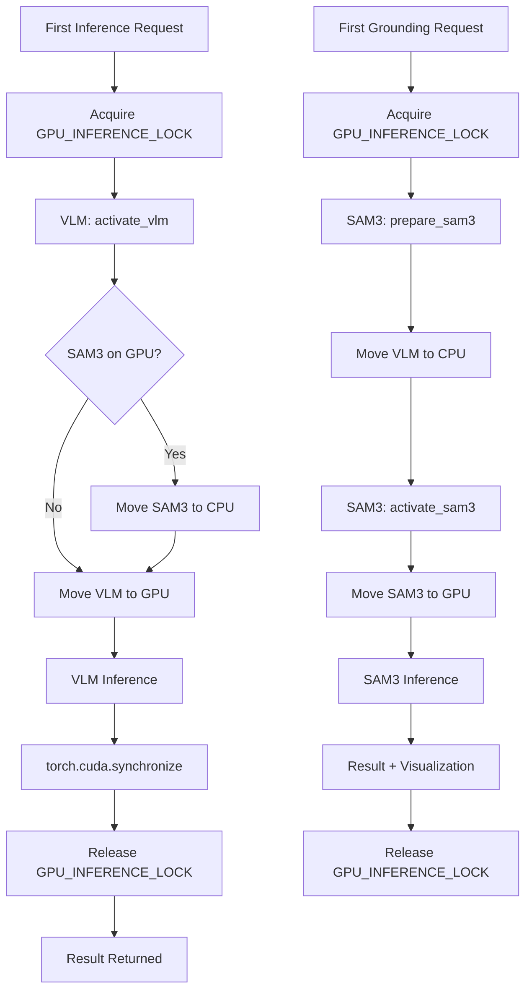
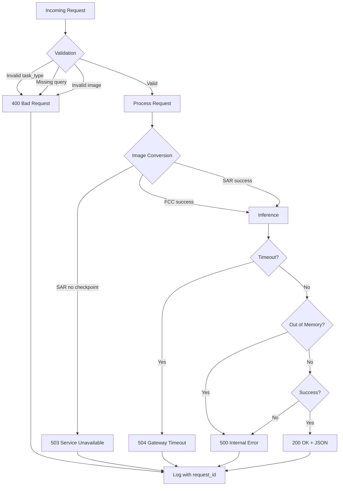

# 02 — System Architecture

## High-Level Architecture

---

## Application Startup Sequence

**Key detail:** The backend starts quickly because models are loaded lazily. The VLM (`CaptioningBackend`) loads on the first inference request, and SAM3 loads on the first grounding request [Code: models/sam3/runtime_service.py:159, backend/core/model.py:471-475].

---

## Request Lifecycle

---

## AI/ML Inference Pipeline

---

## Model Loading and Resource Management Flow

**Critical invariant:** VLM and SAM3 never hold full GPU weights simultaneously. The `GPUModelScheduler` ensures exclusive placement [Code: backend/services/inference_lock.py:58-112].

---

## Error Handling Flow

**Error sanitization:** The `_public_inference_error` function converts internal errors to user-friendly messages without leaking implementation details [Code: backend/api/routes.py:36-44].

---

## Component Interaction Summary

| Component | Talks To | Protocol |
|---|---|---|
| Frontend (React) | Flask Backend | HTTP (multipart/form-data or JSON) |
| Flask Routes | ModelManager | Python function calls |
| ModelManager | CaptioningBackend, VQABackend | Python function calls |
| CaptioningBackend | Hugging Face Hub | HTTPS (first load only) |
| CaptioningBackend | GPU Scheduler | Python (move_to) |
| SAM3 Runner | SAM3 Service | Python (in-process) |
| SAM3 Service | SAM3 Checkpoint | File I/O |
| SAR Converter | Pix2Pix Model | Python (in-process) |
| GPU Scheduler | CUDA | PyTorch API |

---

## External Dependencies and Services

| Service | Purpose | Required? | Network |
|---|---|---|---|
| Hugging Face Hub | Download Qwen3-VL-2B-Instruct | Yes (first run) | HTTPS |
| facebook/sam3 | SAM3 checkpoint download | Yes (grounding) | HTTPS |
| CUDA GPU | Model inference | Highly recommended | Local |
| Vercel (optional) | Frontend hosting + proxy | No | HTTPS |

---

## Configuration and Environment Variables

| Variable | Default | Purpose |
|---|---|---|
| `BACKEND_PORT` | 8000 | Flask listen port |
| `BACKEND_HOST` | 0.0.0.0 | Flask bind address |
| `ADV_VLM_MODEL_ID` | Qwen/Qwen3-VL-2B-Instruct | Shared VLM backbone |
| `ADV_VLM_TEMPERATURE` | 0.2 | Sampling temperature |
| `ADV_VLM_MAX_NEW_TOKENS` | 64 | Generation cap |
| `CAPTIONING_MODEL_DIR` | models/captioning-model | LoRA adapter location |
| `VQA_MODEL_DIR` | models/vqa-model | Fine-tuned VQA checkpoint |
| `SAM3_ROOT` | models/sam3 | SAM3 pipeline location |
| `SAR2OPTICAL_CHECKPOINT` | models/SAR2Optical/pix2pix_gen_180.pth | Pix2Pix weights |
| `HF_TOKEN` | — | Hugging Face auth (if needed) |
| `GEONLI_LOG` | geonli.log | Backend log file |

---

*Next: [Complete Codebase Walkthrough](03_complete_codebase_walkthrough.md)*
