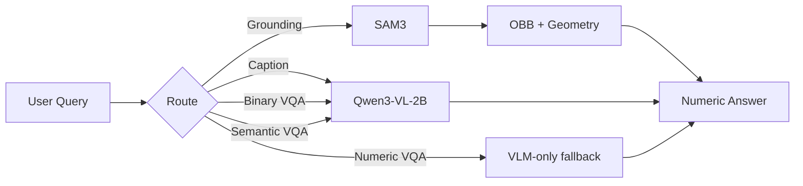

# 05 — Models and Model Selection

## Model Inventory

### 1. Qwen/Qwen3-VL-2B-Instruct — Shared VLM Backbone

| Attribute | Value | Evidence |
|---|---|---|
| **Model ID** | `Qwen/Qwen3-VL-2B-Instruct` | [Code] backend/config.py:5 |
| **Architecture** | Qwen3VLForConditionalGeneration (vision-language transformer) | [Code] models/vqa.py:10 |
| **Parameters** | ~2B (inferred from model name) | [Inferred] |
| **Precision** | bfloat16 on CUDA, float32 on CPU | [Code] models/captioning.py:68 |
| **Task** | Image captioning, binary VQA, semantic VQA | [Code] backend/core/model.py |
| **Loaded via** | `AutoModelForImageTextToText.from_pretrained()` | [Code] models/captioning.py:110 |
| **Attention** | SDPA (scaled dot-product attention) | [Code] models/captioning.py:103 |
| **Pixel bounds** | min 256×256, max 384×384 | [Code] models/captioning.py:21-22 |
| **Device** | CPU by default, GPU during inference | [Code] models/captioning.py:49 |
| **Required?** | Yes (auto-downloaded from HF Hub) | [Code] |

**Why selected:** A 2B-parameter VLM is small enough to fit alongside SAM3 on a 6 GiB GPU with the swapping scheduler, while still providing strong vision-language understanding for captioning and VQA. [Inferred from code comments about 6 GiB cards]

**Strengths:**
- Small enough for constrained GPU memory
- Native image-text understanding via processor
- Publicly available on Hugging Face

**Weaknesses:**
- 2B parameters may limit reasoning complexity
- Not fine-tuned for remote sensing domain (without adapter)

---

### 2. Qwen/Qwen3-VL-8B-Instruct + LoRA Adapter — Captioning Enhancement

| Attribute | Value | Evidence |
|---|---|---|
| **Base model** | `Qwen/Qwen3-VL-8B-Instruct` | [Config] models/captioning-model/model/adapter_config.json:6 |
| **Adapter type** | LoRA (Low-Rank Adaptation) | [Config] adapter_config.json:25 |
| **LoRA rank (r)** | 16 | [Config] adapter_config.json:28 |
| **LoRA alpha** | 32 | [Config] adapter_config.json:19 |
| **LoRA dropout** | 0.05 | [Config] adapter_config.json:21 |
| **Target modules** | up_proj, down_proj, k_proj, q_proj, o_proj, gate_proj, v_proj | [Config] adapter_config.json:31-39 |
| **Task type** | CAUSAL_LM | [Config] adapter_config.json:41 |
| **Training state** | epoch=1, step=6426 | [Config] models/captioning-model/training_state.json |
| **Required?** | No — graceful fallback to base model | [Code] models/captioning.py:57-58 |

**Why selected:** LoRA provides parameter-efficient fine-tuning. The adapter adds remote-sensing captioning capability to the 8B model without requiring a full fine-tune. [Inferred]

**Note:** The adapter targets the 8B base, but the default `ADV_VLM_MODEL_ID` is the 2B model. The code validates this match and raises an error if mismatched [Code: models/captioning.py:80-83]. To use the adapter, `ADV_VLM_MODEL_ID` must be set to `Qwen/Qwen3-VL-8B-Instruct`.

---

### 3. Fine-tuned Qwen3-VL-8B VQA Checkpoint

| Attribute | Value | Evidence |
|---|---|---|
| **Location** | `models/vqa-model/` | [Code] backend/config.py:24 |
| **Architecture** | Qwen3VLForConditionalGeneration | [Config] models/vqa-model/config.json:2-3 |
| **Parameters** | 8,767,123,696 (~8.77B) | [Config] model.safetensors.index.json:3 |
| **Total size** | 17,534,247,392 bytes (~17.5 GB) | [Config] model.safetensors.index.json:4 |
| **Shards** | 4 safetensors files | [Config] model.safetensors.index.json |
| **Precision** | bfloat16 | [Config] config.json:5 |
| **Text config** | hidden_size=4096, 36 layers, 32 heads | [Config] config.json:17-23 |
| **Vision config** | depth=27, hidden_size=1152, 16 heads | [Config] config.json:49-57 |
| **Training state** | epoch=4, step=10724 | [Config] models/vqa-model/trainer_state.json |
| **RoPE** | mrope_interleaved, sections [24,20,20] | [Config] config.json:27-32 |
| **Required?** | No — falls back to shared VLM | [Code] backend/core/model.py:203-215 |

**Why selected:** Full fine-tuning on VRSBench provides domain-specific VQA performance for remote sensing. The 8B model has greater reasoning capacity than the 2B backbone. [Inferred]

**Strengths:**
- Fine-tuned for remote sensing VQA
- 8B parameters for complex reasoning
- Validated output (binary/numeric/semantic)

**Weaknesses:**
- Large (17.5 GB) — requires significant disk and RAM
- Loads on GPU only (bf16) — no CPU fallback
- Not bundled in repo (gitignored)

---

### 4. SAM3 (Segment Anything Model 3) — Grounding

| Attribute | Value | Evidence |
|---|---|---|
| **Model ID** | `facebook/sam3` | [Code] models/sam3/runtime_service.py:69 |
| **Checkpoint** | `sam3.pt` (not bundled) | [Code] models/sam3/runtime_service.py:63 |
| **Task** | Text-guided segmentation → oriented bounding boxes | [Code] models/sam3/unified_inference.py |
| **Score threshold** | 0.4 | [Code] models/sam3/runtime_service.py:53 |
| **Min area** | 100 pixels | [Code] models/sam3/runtime_service.py:54 |
| **NMS threshold** | 0.6 | [Code] models/sam3/runtime_service.py:55 |
| **CLIP** | Disabled by default | [Code] models/sam3/runtime_service.py:57 |
| **Refiner** | Disabled by default | [Code] models/sam3/runtime_service.py:105 |
| **VLM agent** | Disabled by default | [Code] models/sam3/runtime_service.py:59 |
| **Required?** | Yes for grounding | [Code] |

**Why selected:** SAM3 provides open-vocabulary text-guided segmentation. Users can describe objects in natural language and get precise oriented bounding boxes. [Inferred]

**Strengths:**
- Open-vocabulary (no fixed class list)
- Oriented bounding boxes (not just axis-aligned)
- Text encoder built-in (no separate refiner needed)

**Weaknesses:**
- Checkpoint not bundled (requires download)
- CLIP and VLM filtering disabled (may reduce precision)
- No confidence calibration for remote sensing domain

---

### 5. Pix2Pix UNet — SAR-to-Optical Conversion

| Attribute | Value | Evidence |
|---|---|---|
| **Architecture** | UNet (8 encoder + 7 decoder blocks) | [Code] models/SAR2Optical/src/networks.py:7-80 |
| **Checkpoint** | `pix2pix_gen_180.pth` (not bundled) | [Code] backend/services/sar_converter.py:13-16 |
| **Input** | 256×256 RGB (SAR) | [Code] backend/services/sar_converter.py:41 |
| **Output** | 256×256 RGB (optical) | [Code] backend/services/sar_converter.py:74 |
| **Required?** | Only for SAR inputs | [Code] |

**Why selected:** Pix2Pix is a well-established image-to-image translation architecture. The UNet preserves spatial detail while learning the SAR-to-optical mapping. [Inferred]

**Strengths:**
- Lightweight compared to diffusion models
- Fast inference
- Preserves spatial structure

**Weaknesses:**
- Checkpoint not bundled
- Fixed 256×256 output resolution
- No uncertainty estimation

---

### 6. Mistral-7B-Instruct-v0.2 — Query Router (DISABLED)

| Attribute | Value | Evidence |
|---|---|---|
| **Model ID** | `mistralai/Mistral-7B-Instruct-v0.2` | [Code] backend/services/query_router.py:29 |
| **Status** | Disabled (`router = None`) | [Code] backend/core/model.py:225 |
| **Task** | Route queries to VLM-only or SAM+VLM | [Code] backend/services/query_router.py:342-370 |
| **Precision** | float16 on CUDA, float32 on CPU | [Code] backend/services/query_router.py:42 |

**Why disabled:** Loading a second 7B model competes with Qwen3-VL and SAM3 for limited GPU memory. The router is unnecessary for core flows. [Code: backend/core/model.py:223-225]

**Potential value:** Could improve numeric VQA by routing to SAM+VLM path. [Inferred]

---

## Model Selection Rationale

### Why Qwen3-VL as the VLM backbone?

| Alternative | Why Not Selected |
|---|---|
| BLIP-2 | Smaller VLM, less capable for complex VQA |
| LLaVA | Older architecture, less efficient |
| GPT-4V | API-based, requires network, not self-hosted |
| Qwen3-VL-8B | Too large for 6 GiB GPU with SAM3 |

**Qwen3-VL-2B** provides the best balance of capability and efficiency for a constrained GPU environment. [Inferred]

### Why SAM3 for grounding?

| Alternative | Why Not Selected |
|---|---|
| SAM2 | Older version, less accurate |
| YOLO-OBB | Requires fixed class list, not open-vocabulary |
| CLIP-based | No segmentation, only similarity |
| GroundingDINO | Good alternative, but SAM3 is newer |

**SAM3** provides open-vocabulary text-guided segmentation with oriented bounding boxes, which is ideal for remote sensing where object categories are diverse. [Inferred]

### Why Pix2Pix for SAR conversion?

| Alternative | Why Not Selected |
|---|---|
| CycleGAN | Less stable training |
| Diffusion | Too slow for real-time |
| Transformer-based | Overkill for this task |

**Pix2Pix** is lightweight, fast, and well-suited for paired image-to-image translation. [Inferred]

---

## Model Cooperation

**Note:** The SAM+VLM routed numeric path is implemented but disabled (router=None). All numeric queries currently go through VLM-only. [Code: backend/core/model.py:225]

---

## Pretrained vs. Fine-tuned Status

| Model | Pretrained | Fine-tuned | Evidence |
|---|---|---|---|
| Qwen3-VL-2B-Instruct | Yes | No (used as-is) | [Code] models/captioning.py |
| Qwen3-VL-8B + LoRA | Yes | Yes (LoRA adapter) | [Config] adapter_config.json |
| Qwen3-VL-8B VQA | Yes | Yes (full fine-tune) | [Config] trainer_state.json |
| SAM3 | Yes | No (used as-is) | [Code] models/sam3/runtime_service.py |
| Pix2Pix | No | Yes (trained for SAR→optical) | [Code] models/SAR2Optical/ |

---

*Next: [Training and Fine-Tuning](06_training_and_finetuning.md)*
