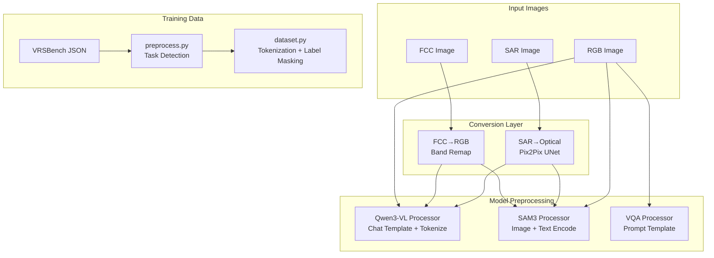

# 07 — Data and Preprocessing

## Data Sources

### Runtime Input Images

| Type | Format | Source | Evidence |
|---|---|---|---|
| RGB | PNG/JPEG | File upload or URL | [Code] backend/utils/image_ops.py:11-18, 20-31 |
| FCC | PNG/JPEG (NIR,R,G) | File upload or URL | [Code] backend/api/routes.py:77-80 |
| SAR | PNG/JPEG | File upload or URL | [Code] backend/api/routes.py:81-83 |
| Upload limit | 16 MB | Hardcoded | [Code] backend/config.py:57 |

### Training Data

| Dataset | Purpose | Location | Evidence |
|---|---|---|---|
| VRSBench | VQA fine-tuning | External (not in repo) | [Config] VQA-fine-tuning/README.md:3 |
| Unknown | Captioning LoRA | External (not in repo) | [Config] adapter_config.json |
| Unknown | Pix2Pix SAR | External (not in repo | [Code] models/SAR2Optical/ |

---

## Preprocessing Pipeline

### 1. Image Loading

**From URL** [Code: backend/utils/image_ops.py:11-18]:
```python
response = requests.get(url, timeout=10)
response.raise_for_status()
return Image.open(BytesIO(response.content)).convert('RGB')
```

**From file upload** [Code: backend/utils/image_ops.py:20-31]:
```python
file_storage.stream.seek(0)
data = file_storage.read()
image = Image.open(BytesIO(data)).convert('RGB')
file_storage.stream.seek(0)
```

Both paths convert to RGB PIL images. The 10-second timeout prevents hanging on slow URLs.

---

### 2. FCC-to-RGB Conversion

**Location:** `backend/utils/image_ops.py:34-55`

**Algorithm:**
```
Input: H×Wx3 array (NIR, Red, Green)
blue_synth = 13.9053 + 0.873393×green + (−0.138254)×red + (−0.100616)×NIR
Output: H×Wx3 array (Red, Green, blue_synth)
```

**Purpose:** False-color composites (NIR, R, G) are common in remote sensing. This linear combination synthesizes a natural-color blue band from the available bands. [Inferred]

**Information preserved:** Red and Green channels unchanged. Blue is synthesized.

**Information discarded:** The NIR channel is used for synthesis but not preserved in output.

---

### 3. SAR-to-Optical Conversion

**Location:** `backend/services/sar_converter.py:39-75`

**Preprocessing:**
1. Convert to RGB [Code: sar_converter.py:67]
2. Resize to 256×256 [Code: sar_converter.py:41]
3. Normalize to [-1, 1] [Code: sar_converter.py:43]

**Post-processing:**
1. Generate prediction [Code: sar_converter.py:70]
2. Clamp to [-1, 1] [Code: sar_converter.py:71]
3. Scale to [0, 255] [Code: sar_converter.py:72]
4. Convert to uint8 [Code: sar_converter.py:73]

**Fixed output size:** 256×256 regardless of input dimensions.

---

### 4. Qwen3-VL Preprocessing

**Location:** `models/captioning.py:172-207`

**Steps:**
1. Build chat message with image + text [Code: captioning.py:175-183]
2. Apply chat template [Code: captioning.py:184-188]
3. Process with Qwen3-VL processor [Code: captioning.py:191-195]
4. Move inputs to model device [Code: captioning.py:199-203]

**Pixel bounds:** min 256×256, max 384×384 [Code: captioning.py:21-22]

**Note:** The processor handles resizing and normalization internally based on min_pixels/max_pixels.

---

### 5. SAM3 Preprocessing

**Location:** `models/sam3/unified_inference.py:238-256`

**Steps:**
1. Open image and convert to RGB [Code: unified_inference.py:245]
2. `processor.set_image(image)` — encodes image [Code: unified_inference.py:248]
3. `processor.set_text_prompt(state, prompt)` — encodes text [Code: unified_inference.py:253]

The SAM3 processor handles its own normalization.

---

### 6. VQA Preprocessing (Fine-tuned Model)

**Location:** `models/vqa.py:112-124`

**Steps:**
1. Build prompt with task-specific suffix [Code: vqa.py:39-48]
2. Process with processor [Code: vqa.py:119-124]
3. Move to device [Code: vqa.py:125]

---

## Training Data Preprocessing

### VRSBench Annotation Processing

**Location:** `VQA-fine-tuning/vrsbench_finetune/preprocess.py`

**Pipeline:**
1. Load JSON annotations [Code: preprocess.py:48-49]
2. Extract qa_pairs and image name [Code: preprocess.py:53-54]
3. Detect task type from answer [Code: preprocess.py:77-96]
4. Format answer text [Code: preprocess.py:88, 93]
5. Output JSONL [Code: preprocess.py:150-152]

**Task Detection:**
- Binary: exact match "yes"/"no" [Code: preprocess.py:18-22]
- Numeric: regex for int/float/scientific [Code: preprocess.py:24-45]
- Semantic: everything else [Code: preprocess.py:95-96]

---

### Dataset Tokenization

**Location:** `VQA-fine-tuning/vrsbench_finetune/dataset.py`

**Steps:**
1. Load image [Code: dataset.py:46-49]
2. Build prompt text [Code: dataset.py:52]
3. Tokenize prompt [Code: dataset.py:57-62]
4. Tokenize answer [Code: dataset.py:73]
5. Concatenate [Code: dataset.py:76]
6. Mask prompt labels (-100) [Code: dataset.py:79-80]

**Label masking:** Only answer tokens contribute to loss. Prompt tokens are masked with -100.

---

## Data Flow Summary



---

## Potential Data Issues

| Issue | Location | Impact |
|---|---|---|
| SAR output fixed at 256×256 | sar_converter.py:41 | Large images lose resolution |
| FCC blue band is synthetic | image_ops.py:44-48 | May not match true color |
| Missing images get black placeholder | dataset.py:48-49 | Training on missing data |
| No train/test split in repo | VQA-fine-tuning/ | Split logic not visible |
| Spatial resolution not validated | backend/api/routes.py:229 | Only checks > 0 |

---

## Data Serialization

| Format | Purpose | Location |
|---|---|---|
| JSONL | Training data | VQA-fine-tuning/data/processed/ |
| JSON | SAM3 intermediate results | models/sam3/intermediate_output.json |
| JSON | SAM3 VLM results | models/sam3/final_output.json |
| JSON | API responses | backend/api/routes.py |
| PNG | Converted images | /tmp/inter-iit/fcc_rgb/, /tmp/inter-iit/sar_rgb/ |
| Base64 JPEG | Grounded visualization | backend/services/sam3_runner.py:80-85 |

---

*Next: [Inference Pipelines](08_inference_pipelines.md)*
