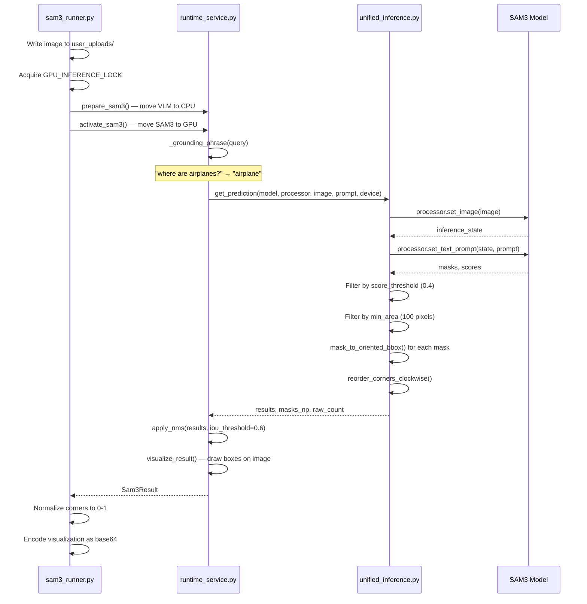

# 08 — Complete Inference Pipelines

## Overview

GeoNLI provides five user-facing inference capabilities:

1. **Scene Captioning** — one-sentence descriptions
2. **Binary VQA** — yes/no questions
3. **Numeric VQA** — count, area, perimeter, length
4. **Semantic VQA** — free-form answers
5. **Text-Guided Grounding** — object localization with bounding boxes

---

## Pipeline 1: Scene Captioning

### User Action
User clicks "Generate caption" button in the CaptionCard component.

### Frontend Event
```javascript
// ui/frontend/src/GeoNLIDashboard.jsx:215-242
const data = await analyzeImage("captioning", "", activeSession.imageFile, ...);
```

### API Request
- **Method:** POST
- **URL:** `/geoNLI/eval`
- **Content-Type:** multipart/form-data
- **Fields:** `image` (file), `task_type` ("captioning"), `image_type`, `spatial_resolution_m`

### Backend Route
```python
# backend/api/routes.py:289-298
if task_type == 'captioning':
    mock_queries['caption_query'] = {'instruction': 'Describe'}
model = get_model()
results = model.process_all_queries(image, image_type, mock_queries, ...)
```

### Model Inference
```python
# backend/core/model.py:423-424
results['caption'] = self._safe_predict(self.captioner.predict, pil_image)
```

```python
# backend/core/model.py:129-137
def predict(self, image):
    prompt = "Describe the main visible content in this image in one concise sentence."
    answer = self.adapter.generate(image, prompt, max_new_tokens=64, max_time=50)
    return {"answer": answer, "prompt": prompt}
```

### Response
```json
{
  "success": true,
  "task": "captioning",
  "answer": "A satellite view of an urban area with dense residential clusters.",
  "response": "A satellite view of an urban area with dense residential clusters.",
  "bboxes": [],
  "request_id": "a1b2c3d4e5f6",
  "timestamp": "2026-10-10T12:00:05+00:00"
}
```

### Frontend Display
The caption appears in the CaptionCard component and can be copied to clipboard.

---

## Pipeline 2: Binary VQA (Yes/No)

### User Action
User selects VQA mode → Binary subtype, types question, presses Enter.

### Frontend Event
```javascript
// ui/frontend/src/GeoNLIDashboard.jsx:244-313
const data = await analyzeImage("vqa", userMsg.content, ..., "binary", ...);
```

### API Request
- **Fields:** `task_type` ("vqa"), `vqa_type` ("binary"), `query` (question text)

### Backend Route
```python
# backend/api/routes.py:293
mock_queries['attribute_query'] = {vqa_type: {'instruction': query_text}}
```

### Model Inference
```python
# backend/core/model.py:435-441
if 'binary' in attr_q:
    results['attr_binary'] = self._safe_predict(
        self._process_routed_query, pil_image,
        attr_q['binary'].get('instruction', ''), 'binary',
    )
```

```python
# backend/core/model.py:346-355
def _process_routed_query(self, image, instruction, task_type):
    query = (instruction or "").strip()
    if task_type not in {"binary", "numeric"}:
        return self._vlm_only_answer(image, query, task_type)
    if self.router is None:
        return self._vlm_only_answer(image, query, task_type)
```

Since `router` is None, goes to `_vlm_only_answer`:

```python
# backend/core/model.py:251-274
def _vlm_only_answer(self, image, query, task_type, ...):
    result = self.vqa.predict(image, query, task_type)
    result["route"] = "VLM_ONLY"
    if task_type == "binary":
        result["answer"] = self._canonical_binary_answer(result.get("answer", ""))
```

```python
# backend/core/model.py:276-286
def _canonical_binary_answer(self, text):
    lowered = (text or "").strip().lower()
    if "yes" in lowered and "no" not in lowered:
        return "Yes"
    if "no" in lowered and "yes" not in lowered:
        return "No"
    if lowered.startswith("yes"):
        return "Yes"
    if lowered.startswith("no"):
        return "No"
    raise ValueError("The VLM did not return a valid yes/no answer")
```

### VLM Prompt
```python
# backend/core/model.py:170-174
instruction = {
    'binary': 'Answer with Yes or No only. ',
    'numeric': 'Answer with a number only. ',
    'semantic': 'Answer concisely in one sentence. ',
}.get(task_type, '')
token_limit = {'binary': 8, 'numeric': 16, 'semantic': 64}.get(task_type, 64)
```

Binary questions get max 8 tokens (enough for "Yes" or "No").

### Response
```json
{
  "success": true,
  "task": "vqa",
  "answer": "Yes",
  "response": "Yes",
  "bboxes": [],
  "route": "VLM_ONLY"
}
```

---

## Pipeline 3: Numeric VQA (Count/Area/Perimeter/Length)

### User Action
User selects VQA mode → Numeric subtype, types question.

### Model Inference Path
Since `router = None`, all numeric queries go VLM-only:

```python
# backend/core/model.py:267-271
elif task_type == "numeric":
    numeric_value = self._extract_first_float(result.get("answer", ""))
    if numeric_value is not None:
        result["numeric_value"] = numeric_value
        result["answer"] = numeric_value
```

### Response
```json
{
  "success": true,
  "task": "vqa",
  "answer": "42",
  "response": "42",
  "bboxes": [],
  "route": "VLM_ONLY",
  "numeric_type": "NONE",
  "numeric_value": 42.0
}
```

**Note:** The SAM+VLM routed path (which computes values from SAM3 detections) is implemented but disabled. See `_process_routed_query` lines 357-412 for the dead code path.

---

## Pipeline 4: Semantic VQA

### User Action
User selects VQA mode → Semantic subtype, types question.

### Model Inference
```python
# backend/core/model.py:451-457
if 'semantic' in attr_q:
    results['attr_semantic'] = self._safe_predict(
        self.vqa.predict, pil_image,
        attr_q['semantic'].get('instruction', ''), 'semantic',
    )
```

### VLM Prompt
```python
# backend/core/model.py:176-178
answer = self.adapter.generate(pil_image, instruction + prompt, max_new_tokens=64)
```

Semantic questions get the full 64-token budget.

---

## Pipeline 5: Text-Guided Grounding

### User Action
User selects Grounding mode, types description (e.g., "Find water bodies"), presses Enter.

### Frontend Event
```javascript
const data = await analyzeImage("grounding", userMsg.content, ..., "grounding", ...);
```

### API Request
- **Fields:** `task_type` ("grounding"), `query` (description)

### Backend Route
```python
# backend/api/routes.py:268-285
if task_type == 'grounding':
    sam3_payload = run_sam3_grounding(
        image_bytes, query_text,
        getattr(file, 'filename', None),
        spatial_resolution_m=spatial_resolution_m,
    )
```

### SAM3 Service Pipeline



### Response
```json
{
  "success": true,
  "task": "grounding",
  "answer": "Grounding completed for 'water body'.",
  "response": "Grounding completed for 'water body'.",
  "bboxes": [[0.1, 0.2, 0.4, 0.2, 0.4, 0.5, 0.1, 0.5]],
  "grounded_image": "data:image/jpeg;base64,...",
  "raw_detection_count": 3,
  "filtered_instances": [...]
}
```

### Frontend Display
The Stage component renders the bounding boxes as SVG polygons over the image:

```javascript
// ui/frontend/src/components/Stage.jsx:96-118
const getPolygonPoints = bbox => {
    const coords = bbox.obbox || bbox;
    if (Array.isArray(coords) && coords.length >= 8) {
        return coords.slice(0, 8).map(c => c * 100).reduce((acc, val, i, arr) => {
            if (i % 2 === 0) acc.push(`${val},${arr[i + 1]}`);
            return acc;
        }, []).join(" ");
    }
    // ...
};
```

---

## GPU Scheduling in Pipelines

### VLM Pipelines (Captioning, Binary, Semantic)
```python
# backend/core/model.py:99-106
waiting = time.monotonic()
with GPU_INFERENCE_LOCK, self._lock:
    placement_wait_s = GPU_MODEL_SCHEDULER.activate_vlm()
    result = self.model.generate(text_input, pil_image, **generate_kwargs)
```

1. Acquire global GPU lock (FIFO)
2. Move SAM3 to CPU (if on GPU)
3. Move VLM to GPU
4. Run inference
5. Release lock

### Grounding Pipeline
```python
# backend/services/sam3_runner.py:101-112
with GPU_INFERENCE_LOCK:
    GPU_MODEL_SCHEDULER.prepare_sam3()  # VLM to CPU
    service = _get_sam3_service()
    with SAM3_LOCK:
        GPU_MODEL_SCHEDULER.activate_sam3(service)  # SAM3 to GPU
        result = service.ground(upload_path, cleaned_query)
```

1. Acquire global GPU lock
2. Move VLM to CPU
3. Move SAM3 to GPU
4. Run grounding
5. Release lock

**Invariant:** VLM and SAM3 never hold GPU memory simultaneously.

---

## Failure Points and Diagnostics

| Failure | Symptom | Diagnostic |
|---|---|---|
| VLM timeout | 504 error | Check logs for "time limit" |
| VLM OOM | 500 error with "GPU memory" | Check nvidia-smi, reduce image size |
| SAM3 checkpoint missing | 503 error | Check SAM3_CHECKPOINT env var |
| SAR checkpoint missing | 503 error | Check SAR2OPTICAL_CHECKPOINT env var |
| Invalid binary answer | 500 error | VLM output doesn't contain yes/no |
| Empty VLM answer | 500 error | VLM returned empty string |
| Corrupt image upload | 400 error | "Could not decode the uploaded image" |

---

## Concurrency

- **VLM:** Protected by `GPU_INFERENCE_LOCK` (FIFO) + instance `_lock`
- **SAM3:** Protected by `GPU_INFERENCE_LOCK` + `SAM3_LOCK`
- **SAR converter:** Protected by `_CONVERTER_LOCK` (thread-safe singleton)
- **Model manager:** Protected by `_manager_lock` (thread-safe singleton)

**Fairness:** The FIFO lock ensures a stream of VLM calls cannot starve SAM3 and vice versa.

---

*Next: [Frontend Walkthrough](09_frontend_walkthrough.md)*
