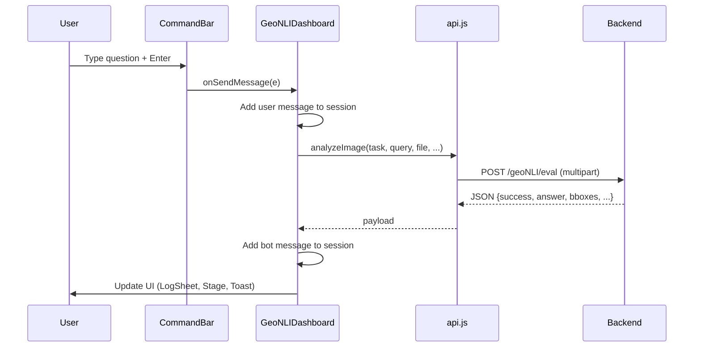

# 09 — Frontend Walkthrough

## Framework and Stack

| Technology | Version | Purpose |
|---|---|---|
| React | 19.2.0 | UI framework |
| Vite | 7.2.4 | Build tool + dev server |
| Tailwind CSS | 4.1.17 | Utility-first styling |
| Lucide React | 0.555.0 | Icon library |
| Fontsource | — | Variable fonts (Fraunces, DM Sans, IBM Plex Mono) |

---

## Entry Point

### `ui/frontend/src/main.jsx`
```javascript
import { StrictMode } from 'react'
import { createRoot } from 'react-dom/client'
import '@fontsource-variable/fraunces'
import '@fontsource-variable/dm-sans'
import '@fontsource/ibm-plex-mono/400.css'
import '@fontsource/ibm-plex-mono/500.css'
import './index.css'
import App from './App.jsx'

createRoot(document.getElementById('root')).render(
  <StrictMode>
    <App />
  </StrictMode>,
)
```

**StrictMode** double-renders effects in development, helping catch bugs.

---

## Component Hierarchy

```
App.jsx
└── GeoNLIDashboard.jsx
    ├── Stage.jsx                    (full-viewport image + SVG overlay)
    ├── SessionStrip.jsx             (top nav bar)
    │   └── StatusBadge.jsx
    ├── SceneInspector.jsx           (image type + resolution controls)
    ├── CaptionCard.jsx              (scene caption)
    ├── CommandBar.jsx               (query input + task mode)
    ├── LogSheet.jsx                 (conversation history)
    ├── HideUiToggle.jsx             (H key toggle)
    ├── DebugPanel.jsx               (API debugger)
    └── ConfirmDialog.jsx            (session termination)
```

---

## State Management

All state lives in `GeoNLIDashboard.jsx` using React hooks:

| State | Type | Default | Purpose |
|---|---|---|---|
| `sessions` | Array | 1 sample session | All analysis sessions |
| `activeSessionId` | Number | 1 | Currently selected session |
| `inputMessage` | String | "" | Command bar text |
| `selectedTask` | String | "grounding" | Task mode |
| `vqaType` | String | "semantic" | VQA subtype |
| `imageType` | String | "RGB" | Image type |
| `spatialResolution` | Number | 1.0 | Meters per pixel |
| `isSimulating` | Boolean | false | Simulation mode |
| `isLoading` | Boolean | false | Request in progress |
| `isGeneratingCaption` | Boolean | false | Caption generation in progress |
| `showDebug` | Boolean | false | Debug panel visibility |
| `isDarkMode` | Boolean | false | Theme |
| `apiStatus` | String | "loading" | Backend status |
| `terminateConfirm` | Object/null | null | Session to terminate |

---

## Key Components

### Stage.jsx — Image Display + Bounding Boxes

**Purpose:** Full-viewport image layer with SVG overlay for bounding boxes.

**Key Features:**
- Drag-and-drop file upload (window-level listeners)
- SVG overlay with `viewBox="0 0 100 100"` for normalized coordinates
- `ResizeObserver` for responsive overlay sizing
- Polygon rendering for 8-point OBBs

**Bounding Box Rendering:**
```javascript
const getPolygonPoints = bbox => {
    const coords = bbox.obbox || bbox;
    if (Array.isArray(coords) && coords.length >= 8) {
        return coords.slice(0, 8).map(c => c * 100).reduce((acc, val, i, arr) => {
            if (i % 2 === 0) acc.push(`${val},${arr[i + 1]}`);
            return acc;
        }, []).join(" ");
    }
    // Fallback for 4-point rect [x, y, w, h]
    if (Array.isArray(coords) && coords.length === 4) {
        const [x, y, w, h] = coords;
        return `${x},${y} ${x + w},${y} ${x + w},${y + h} ${x},${y + h}`;
    }
    return "";
};
```

---

### CommandBar.jsx — Query Input

**Purpose:** Bottom command bar with task mode switch and text input.

**Key Features:**
- Grounding/VQA mode toggle
- VQA subtype selector (binary/numeric/semantic)
- Quick prompt chips (shown before first message)
- Answer toast display

**Quick Prompts:**
```javascript
const QUICK_PROMPTS = {
    grounding: ["Where are the buildings?", "Find water bodies", "Locate the roads"],
    vqa: {
        binary: ["Is there a river?", "Are there vehicles present?"],
        numeric: ["How many ships?", "How many buildings are there?"],
        semantic: ["What is the land use here?", "Describe the terrain"],
    },
};
```

---

### SceneInspector.jsx — Scene Controls

**Purpose:** Image type selector, spatial resolution input, simulation toggle.

**Responsive Design:**
- Desktop (≥1024px): Floating panel, collapsible
- Mobile (<1024px): Bottom sheet with backdrop

---

### SessionStrip.jsx — Session Management

**Purpose:** Top navigation bar with session tabs.

**Key Features:**
- Session tabs with image thumbnails
- Create new session button
- Terminate session with hover X
- Theme toggle, debug panel toggle, log toggle
- Status badge showing backend health

---

### CaptionCard.jsx — Scene Caption

**Purpose:** Bottom-left card for caption generation and display.

**States:**
- Empty: Collapsed to a chip with "Generate caption" button
- Generating: Spinner animation
- Complete: Textarea with copy button

---

### LogSheet.jsx — Conversation History

**Purpose:** Right-side panel showing conversation history.

**Key Features:**
- Auto-scroll to latest message
- User/bot message bubbles
- Bounding box count indicator
- Loading animation (bouncing dots)
- Pin/unpin for auto-close behavior

---

### DebugPanel.jsx — API Debugger

**Purpose:** Floating panel showing current state for debugging.

**Displays:** status, task, type, subtask, image name, last response

---

### StatusBadge.jsx — Backend Status

**Purpose:** Shows backend connection status.

| Status | Label | Color |
|---|---|---|
| ready | System ready | Green |
| loading | Checking backend... | Yellow (pulse) |
| error | Backend error | Red |
| inference-error | Backend online · inference failed | Red |

---

### HideUiToggle.jsx — UI Toggle

**Purpose:** Hides/shows all floating UI with H key.

**Implementation:**
```javascript
useEffect(() => {
    const onKeyDown = e => {
        if (e.key?.toLowerCase() !== "h") return;
        if (e.metaKey || e.ctrlKey || e.altKey) return;
        const el = e.target;
        const tag = el?.tagName?.toLowerCase();
        if (tag === "input" || tag === "textarea" || tag === "select" || el?.isContentEditable)
            return;
        setUiHidden(v => !v);
    };
    window.addEventListener("keydown", onKeyDown);
    return () => window.removeEventListener("keydown", onKeyDown);
}, []);
```

---

### ConfirmDialog.jsx — Confirmation Dialog

**Purpose:** Modal confirmation for destructive actions.

**Features:** Escape key handling, focus management, backdrop click to cancel.

---

## API Client

### `ui/frontend/src/services/api.js`

**Backend URL:**
```javascript
export const BACKEND_BASE_URL = (import.meta.env.VITE_BACKEND_BASE_URL || "http://127.0.0.1:8000").replace(/\/$/, "")
```

**Main Function:**
```javascript
export const analyzeImage = async (taskType, query, imageFile, isSimulating, vqaType, imageType, spatialResolutionM) => {
    if (isSimulating) {
        return simulateBackendResponse(taskType, query, vqaType, imageType);
    } else {
        return fetchRealBackend(taskType, query, imageFile, vqaType, imageType, spatialResolutionM);
    }
};
```

**Request:**
```javascript
const formData = new FormData();
formData.append("image", imageFile);
formData.append("task_type", taskType);
formData.append("image_type", imageType);
formData.append("spatial_resolution_m", spatialResolutionM.toString());
if (taskType === "vqa") {
    formData.append("vqa_type", vqaType);
}
formData.append("query", taskType === "captioning" ? "" : query);

const response = await fetch(`${BACKEND_BASE_URL}/geoNLI/eval`, {
    method: "POST",
    body: formData,
    signal: controller.signal,
});
```

**Timeout:** 90 seconds (accounts for model inference time).

---

## Request Lifecycle



---

## Adding a New Feature

1. **Add state** in `GeoNLIDashboard.jsx`
2. **Create component** in `src/components/`
3. **Add to render** in `GeoNLIDashboard.jsx`
4. **Add API call** in `services/api.js` if needed
5. **Add backend route** in `backend/api/routes.py` if needed

---

## Build and Development Commands

```bash
cd ui/frontend
npm install          # Install dependencies
npm run dev          # Start dev server (port 5173)
npm run build        # Production build (dist/)
npm run lint         # ESLint
npm run preview      # Preview production build
```

---

*Next: [Backend and API Reference](10_backend_and_api_reference.md)*
